# 00 · Architecture

The pieces of Flowtinus and how a run goes through them. Read this first: the other pages zoom into one part of it.

<b>Step by step</b>: open to watch each step on its own, at its own pace

 

**1.** The editor (React) only talks to the API server; every screen is a call under /w/:ws/…

**2.** A run is a row in Postgres: queued with a snapshot of the flow; NOTIFY wakes the supervisors

**3.** A supervisor claims it and a worker process runs the engine, which reads and writes the outside systems

**4.** Progress and the end go back to Postgres; the API pushes them to the editor over SSE

**5.** An agent works through /mcp with a personal access token: the same use cases as the editor

**6.** Another system calls a webhook; the supervisors fire the schedules: both run the deployed version

**7.** The API and the supervisors log JSON; the otel-collector sends it to OpenObserve

## Where things live

An environment (one instance: one database, `ENVIRONMENT=DEV`/`QA`/`PROD`) has its users, its supervisors and workers
(worker tags are the environment's) and its **workspaces**. A workspace holds projects and, for all of them, the
connection profiles, secrets and variables; a project holds folders and flows (versions, deployments, runs), scripts,
webhooks and schedules. A user is a member of workspaces, with a role in each (viewer, editor, admin); a personal access
token is its user's. The editor and the API address a workspace's data under `/w/<its slug>/...`; the runs and the
workers are the environment's (`/runs` lists the runs of the user's workspaces).

## The pieces

| Piece             | Where                                                           | What it does                                                                                                                                                                                                |
| ----------------- | --------------------------------------------------------------- | ----------------------------------------------------------------------------------------------------------------------------------------------------------------------------------------------------------- |
| **Editor**        | `flowtinus.editor`                                              | The React app (`:5180` in development). It only talks to the API server.                                                                                                                                    |
| **API server**    | `flowtinus.server/api`                                          | The editor's API under `/w/:ws/...`, the run events (SSE), `/mcp` for agents and `/wh/:id` for webhooks. Validates a flow, snapshots everything a run needs into a queued row, and wakes the supervisors.   |
| **Postgres**      | tables `runs`, `test_runs`, `supervisors`, ...                  | The queue, the source of truth for each run's state, and the message bus (`LISTEN` / `NOTIFY`).                                                                                                             |
| **Supervisor**    | `flowtinus.server/supervisor/supervisor.ts`                     | One process per container. Claims queued runs of its tags, prepares each one (decrypts secrets), hands it to a worker, writes progress and the end, keeps heartbeats, reaps lost runs, fires the schedules. |
| **Worker**        | `flowtinus.server/supervisor/workers/worker.ts`                 | A child `bun` process of the supervisor. Runs one job at a time and never touches the database: it gets everything in the job and answers over IPC.                                                         |
| **Engine**        | `flowtinus.core/src/engine/flow-runner.ts`, `flow-execution.ts` | Runs a flow inside the worker: every edge becomes a bounded channel, every component runs concurrently, envelopes stream through.                                                                           |
| **Workers page**  | `flowtinus.editor/src/pages/workers/workers-page.tsx`           | A read-only view of the `supervisors` table: tags, workers, busy now, queued per tag, online or lost.                                                                                                       |
| **Observability** | `observability/`, `docker compose --profile observability`      | The otel-collector takes the JSON logs and the metrics to OpenObserve (`:5080`).                                                                                                                            |

## Where to go next

| To understand                                | Read                                                                                              |
| -------------------------------------------- | ------------------------------------------------------------------------------------------------- |
| What happens between Run and the record      | [01 · Editor → Server → Supervisor → DB](01-editor-server-supervisor-db.md)                       |
| How several supervisors share one queue      | [02 · Claiming runs](02-claiming-runs.md), [03 · Worker tags](03-worker-tags.md)                  |
| What happens when a supervisor dies          | [04 · Heartbeats and lost runs](04-heartbeats-and-lost-runs.md)                                   |
| What runs inside a worker                    | [05 · The worker pool](05-worker-pool.md), [06 · The engine](06-engine-envelopes.md)              |
| What a deploy freezes, and what triggers run | [07 · Deploys](07-deploys.md), [09 · Schedules](09-schedules.md), [10 · Webhooks](10-webhooks.md) |

---

[Index](README.md) · [01 · Editor → Server → Supervisor → DB →](01-editor-server-supervisor-db.md)
