# 01 · Editor → Server → Supervisor → DB: a run, end to end

What happens between clicking **Run** in the editor and the run's record showing up: who asks, where the run waits, who
takes it, who executes it and how the editor hears about it.

## Step by step

The animation above plays the whole run. Open a step to watch only that part, at its own pace.

<b>1 · The editor asks for a run</b>

 

`POST /w/:ws/flows/:id/runs` (Run or Run for real). `StartRunHandler` first checks that a live supervisor has the
flow's `worker_tag` (`hasLiveSupervisor`). Otherwise the run is refused at once (`502`, _"No worker takes the tag …"_),
because it would wait in the queue forever.

<b>2 · It is queued</b>

 

The handler inserts a row in `runs` (Run for real, deployed versions, fire and forget calls) or `test_runs` (the
editor's Run, one per flow and user, kept a day). The row carries a snapshot of everything the run needs: the flow's
draft, the scripts it imports (by hash), the flows its Flow Invokers may call, parameters and input. Editing the flow
afterwards does not change a queued run.

<b>3 · The supervisors are woken</b>

 

`NOTIFY runs_queued, '<tag>'`. Each supervisor `LISTEN`s on that channel and only reacts when the tag is one of its
`WORKER_TAGS`.

<b>4 · One supervisor claims it</b>

 

`UPDATE … FOR UPDATE SKIP LOCKED` ([02 · Claiming runs](02-claiming-runs.md)): the row becomes `running`, with
`started_at`, `heartbeat_at` and `worker_id` = the supervisor's id.

<b>5 · The supervisor prepares a RunJob</b>

 

`prepareJob`: the flow, parameters, input, the connection profiles and variables of its workspace, and the
workspace's secrets decrypted with the keyring. Secrets live only in memory, in the supervisor and then in the worker,
for that run. The job goes to a free worker over IPC (`{ type: 'run', job }`).

<b>6 · A worker runs it</b>

 

The worker calls the engine (`runJob` → `flowRunner`) and sends `progress` every 250 ms. The supervisor saves each
progress to the row's `progress` column (when writes pile up, only the latest one waits), announces it with
`NOTIFY run_events`, and beats every 5 s ([04 · Heartbeats](04-heartbeats-and-lost-runs.md),
[05 · The worker pool](05-worker-pool.md), [06 · The engine](06-engine-envelopes.md)).

<b>7 · The worker answers done</b>

 

`finishRun` stores the record, the status (`cancelled` if Stop was asked), duration, CPU and peak memory.

<b>8 · The editor hears about it</b>

 

The API listens on `run_events` and pushes each change to `GET /runs/:id/events` (SSE): the run page and the Runs
page follow it live.

## The channels

Postgres is the queue, the source of truth for each run's state, and the message bus. A `NOTIFY` makes the start of a
run immediate, but it is lost if nobody is listening at that moment, so every supervisor also polls every 5 s
([02 · Claiming runs](02-claiming-runs.md)). The channels (`CHANNELS` in `run-queue.ts`):

| Channel       | Sent by                                            | Payload                                     | Who listens                                   |
| ------------- | -------------------------------------------------- | ------------------------------------------- | --------------------------------------------- |
| `runs_queued` | API (new run), supervisor (fire and forget child)  | the run's worker tag                        | supervisors (only for their tags)             |
| `run_cancel`  | API (Stop on a running run, a replaced test run)   | the run's id                                | supervisors (the one that has it stops it)    |
| `run_events`  | supervisor (claimed, progress, done), API (queued) | `{ id, type, workspaceId, rootId, status }` | API → SSE to the editor (run page, Runs page) |

## In the code

| Step                                         | File                                                            |
| -------------------------------------------- | --------------------------------------------------------------- |
| The route                                    | `flowtinus.server/api/routes/flows.routes.ts` (`/:id/runs`)     |
| Checks, snapshot, insert, `NOTIFY`           | `flowtinus.server/features/runs/start-run/start-run-handler.ts` |
| Queue, claim, channels                       | `flowtinus.server/features/runs/run-queue.ts`                   |
| `RunJob` (secrets, connections), `finishRun` | `flowtinus.server/features/runs/run-job.ts`                     |
| The supervisor's loop                        | `flowtinus.server/supervisor/supervisor.ts`                     |
| The worker and its IPC                       | `flowtinus.server/supervisor/workers/`                          |
| The engine                                   | `flowtinus.core/src/engine/flow-runner.ts`, `flow-execution.ts` |

---

[← 00 · Architecture](00-architecture.md) · [Index](README.md) · [02 · Claiming runs →](02-claiming-runs.md)
