# 02 · Claiming runs

Several supervisors may share the same database and the same tags (`docker compose --scale supervisor=3`, or replicas
in Kubernetes). This page shows how a run goes to exactly one of them, without them ever waiting for each other.

<p align="center"></p>

<details>
<summary><b>Step by step</b>: open to watch each step on its own, at its own pace</summary>
<br>

**1.** A run was queued: NOTIFY runs_queued wakes both supervisors


**2.** A locks R1 first: the highest priority, then the oldest


**3.** B finds R1 locked: SKIP LOCKED makes it take the next one, R2, without waiting


**4.** Each UPDATE marks its row running with its worker_id: a run goes to exactly one supervisor


**5.** A still has a free worker: it claims again (fill loops while active < WORKERS)


**6.** Both are full: R4 waits; the next free worker (a run ends, or the 5 s poll) claims it



</details>

## The query

`claimRun` (`features/runs/run-queue.ts`):

```sql
UPDATE runs SET status = 'running', started_at = now(), heartbeat_at = now(), worker_id = $2
WHERE id = (
  SELECT id FROM runs
  WHERE status = 'queued' AND worker_tag = ANY($1::text[])
  ORDER BY priority DESC, queued_at
  FOR UPDATE SKIP LOCKED
  LIMIT 1
)
RETURNING …
```

- `FOR UPDATE` locks the chosen row until the transaction ends; `SKIP LOCKED` makes a concurrent claimer **skip** locked
  rows instead of waiting for them. Two supervisors racing for the same run never block each other and never both get
  it: the second one simply gets the next row.
- `test_runs` are tried first (someone is watching the editor), then `runs`; inside a table, the highest `priority`,
  then the oldest `queued_at`. The partial index `runs_queue (worker_tag, priority, queued_at) WHERE status = 'queued'`
  keeps this cheap.

## When a supervisor claims

- `Supervisor.fill()` loops `claimRun` **while it has free workers** (`active.size < executor.size`), so a supervisor
  never takes more runs than it can execute. Only one fill runs at a time; a wake-up during a fill makes it look again
  once it ends.
- A fill happens on every `NOTIFY runs_queued` of its tags, when one of its runs ends (a worker became free), when it
  queues a fire and forget run, and every `pollMs` (5 s) in case a `NOTIFY` was missed.

## NOTIFY + poll

`LISTEN` / `NOTIFY` makes the start of a run immediate, but a notification is lost if nobody is listening at that
moment (a reconnect, a supervisor starting). The 5-second poll is the safety net: whatever happens, a queued run is
picked up within `pollMs` once a worker is free. The channels are listed in
[01 · Editor → Server → Supervisor → DB](01-editor-server-supervisor-db.md#the-channels).

## In the code

| What                   | File                                                                                            |
| ---------------------- | ----------------------------------------------------------------------------------------------- |
| Claim, queue, channels | `flowtinus.server/features/runs/run-queue.ts`                                                   |
| Fill loop, poll        | `flowtinus.server/supervisor/supervisor.ts`                                                     |
| Tests                  | `flowtinus.server/tests/integration/run-queue.test.ts`, `tests/containers/supervisor-*.test.ts` |

---

[← 01 · Editor → Server → Supervisor → DB](01-editor-server-supervisor-db.md) · [Index](README.md) · [03 · Worker tags →](03-worker-tags.md)
