# 03 · Worker tags

A tag decides **which supervisors run a flow**: heavy flows on bigger containers, a team's flows on its own
supervisors, and so on.

<b>Step by step</b>: open to watch each step on its own, at its own pace

 

**1.** A flow’s tag (its settings) is copied to each run it queues: runs.worker_tag

**2.** The API refuses a run whose tag no live supervisor has: it would wait forever

**3.** A supervisor only claims the runs whose tag is in its WORKER_TAGS; its replicas share the queue

**4.** WORKER_COLOR paints the tag on the screens; WORKERS = runs at the same time per container

## The flow's tag

A tag is set per flow (flow settings, `PUT /w/:ws/flows/:id/worker-tag`) and copied into every run the flow queues
(`runs.worker_tag`); runs already queued keep the tag they were queued with. A tag is lowercase letters, digits, `-` and
`_`, up to 40 characters; the default is `default`.

## The supervisor's settings

Each supervisor container is configured with environment variables (`shared/config/app-settings.ts`, see
`.env.example` and `docker-compose.yml`):

| Variable                     | Default             | Meaning                                                                                                                                                                                     |
| ---------------------------- | ------------------- | ------------------------------------------------------------------------------------------------------------------------------------------------------------------------------------------- |
| `WORKER_TAGS`                | `default`           | Comma-separated tags this supervisor claims runs for.                                                                                                                                       |
| `WORKERS`                    | `1`                 | Worker processes it starts = runs it executes at the same time (one worker = one run).                                                                                                      |
| `WORKER_COLOR`               | none                | The color its tags take on the screens (Workers page, tag chips): a name (`violet`, `sky`, `amber`, …) or `#rrggbb`.                                                                        |
| `FIRE_AND_FORGET_PER_WORKER` | `4`                 | How many runs one Flow Invoker may fire and forget in a run, per worker: the limit is this × `WORKERS` (e.g. 12 workers → 48). Past it, the last batches grow instead of queuing more runs. |
| `SUPERVISOR_NAME`            | container/host name | How the Workers page names it.                                                                                                                                                              |

## Typical setups

- **Scale out a tag:** run more replicas of the same service (`docker compose --profile server up -d --scale
supervisor=3`). They share the queue; each run goes to one of them.
- **Isolate heavy work:** add a service with its own `WORKER_TAGS=heavy`, `WORKERS` and resource limits (the commented
  `supervisor-heavy` in `docker-compose.yml`), and give the heavy flows the `heavy` tag.
- **A tag nobody serves** cannot run: the API refuses it (`502`, and so does a fire and forget call to a flow with that
  tag, in `queueCalledRun`), and the editor says so.

## In the code

| What                                            | File                                                                                   |
| ----------------------------------------------- | -------------------------------------------------------------------------------------- |
| Tags, the Workers page API, `hasLiveSupervisor` | `flowtinus.server/features/supervisors/supervisors.ts`                                 |
| Settings                                        | `flowtinus.server/shared/config/app-settings.ts`, `.env.example`, `docker-compose.yml` |
| The Workers page                                | `flowtinus.editor/src/pages/workers/workers-page.tsx`                                  |

---

[← 02 · Claiming runs](02-claiming-runs.md) · [Index](README.md) · [04 · Heartbeats and lost runs →](04-heartbeats-and-lost-runs.md)
