# 04 · Heartbeats and lost runs

How the supervisors know about each other, and what happens to a run when the supervisor running it dies.

<b>Step by step</b>: open to watch each step on its own, at its own pace

 

**1.** Every 5 s each supervisor bumps its last_seen and the heartbeat_at of the runs it has

**2.** B dies with R7 running: its rows stop moving

**3.** A’s poll runs reapGone: B unseen for 60 s → failRunsOf(B), then its row goes

**4.** Also: reapStaleRuns fails any running run whose heartbeat_at is older than 60 s

## Registration

On start, and again on every heartbeat, a supervisor upserts its row in `supervisors`: `id` (`<host>-<pid>-<random>`),
`tags`, `workers`, `host` (its name), `color`, `fire_and_forget_per_worker`, `last_seen = now()`. Re-registering on each
beat means a row that was taken for gone (after a long pause) comes back by itself. On a clean stop (`SIGINT`,
`SIGTERM`) it stops claiming, ends its runs as failed (_"The supervisor stopped."_) and deletes its row.

## Heartbeats

Every `heartbeatMs` (5 s):

- `heartbeat()` sets `heartbeat_at = now()` on every run it is executing;
- `register()` sets its own `last_seen = now()`.

## Reaping

Every `pollMs` (5 s), by every supervisor, before filling:

- `reapGone()` looks at the other supervisors. One not seen for `SUPERVISOR_LOST_AFTER_MS` (60 s) is gone; sooner, one
  **on the same host** whose **process no longer exists** and that missed two heartbeats (10 s) is gone too (a restart
  in development, a crash). Both conditions are required for the fast path: two containers with the same host name
  would otherwise see each other's pids as dead. For a gone supervisor, `failRunsOf` fails its running runs (_"The
  supervisor running it stopped."_) and its row is deleted.
- `reapStaleRuns()` fails any `running` run whose `heartbeat_at` is older than `STALE_AFTER_MS` (60 s), whoever owned it
  (_"The worker running it stopped answering"_). The update re-checks the condition, so a run that just got a heartbeat
  is not failed.
- A lost run keeps what it did: its record is built from its last `progress`, marked failed.
- Once an hour, test runs older than a day are deleted.

## The Workers page

It reads `listWorkers()`: each supervisor with its tags, workers, `busy` (its running runs in both tables), color and
`last_seen`, plus the queued runs per tag. A supervisor is shown **online** while `last_seen` is under 60 s old and
**lost** after that, until another supervisor's reap deletes it. The page follows changes live and per tag shows what
serves it and what waits.

## In the code

| What                                                    | File                                                              |
| ------------------------------------------------------- | ----------------------------------------------------------------- |
| Heartbeat, reap, stale runs                             | `flowtinus.server/features/runs/run-queue.ts`                     |
| Registration, `listWorkers`, `SUPERVISOR_LOST_AFTER_MS` | `flowtinus.server/features/supervisors/supervisors.ts`            |
| The loop (beat, poll, stop)                             | `flowtinus.server/supervisor/supervisor.ts`, `supervisor/main.ts` |

---

[← 03 · Worker tags](03-worker-tags.md) · [Index](README.md) · [05 · The worker pool →](05-worker-pool.md)
