# 05 · The worker pool

Inside a supervisor: the worker processes, what they say to each other over IPC, and what happens when a run is
stopped, takes too long or a worker dies.

<b>Step by step</b>: open to watch each step on its own, at its own pace

 

**1.** processPool spawns WORKERS bun processes (worker.ts); each one answers { type: ready } over IPC

**2.** The supervisor claims a run, prepareJob decrypts its secrets, and a free worker gets { type: run, job }

**3.** Every 250 ms the worker sends progress; the supervisor saves it and NOTIFYs run_events

**4.** A worker never touches the database: OAuth 2.0 tokens and fire and forget calls go through the supervisor

**5.** { type: done } brings the record and usage: finishRun stores them, and the worker is free again

**6.** Stop: NOTIFY run_cancel → { type: cancel }. Not ended 5 s later? The worker is killed. Either way, it is replaced

**7.** After 100 runs, or a run past 1 GiB, a worker is replaced between runs: what a run leaks does not pile up

`processPool` (`supervisor/workers/process-pool.ts`) keeps `WORKERS` slots, each with one `bun` child process talking
JSON over IPC (`protocol.ts`):

- **One run per worker.** `run()` picks a free slot; the supervisor never hands more runs than `size`.
- **OAuth 2.0 tokens** are fetched by the supervisor and kept in its memory for all its workers (asked once per
  connection, kept when a worker is replaced, never stored in the database).
- **Fire and forget** calls from a Flow Invoker in a real run are queued by the supervisor as child runs (`parent_id`,
  `root_id`, `trigger = 'flow-invoker'`) that any supervisor with the called flow's tag may take. Test runs execute their
  calls inline instead.
- **Stop:** `POST /runs/:id/cancel` sets `cancel_requested` and sends `NOTIFY run_cancel`; the supervisor that has the
  run sends `cancel` to its worker, the engine stops at its next step, and if the run has not ended after 5 s the worker
  is killed. A stopped worker is always replaced, so nothing it left running leaks into the next run.
- **Recycling:** a worker is replaced after 100 runs or when a run took its memory past 1 GB.
- **Timeouts:** the engine stops a run after 10 minutes (`RUN_TIMEOUT_MS`); the pool kills the worker at 11 minutes if
  the engine did not.
- **A worker that dies** mid-run fails that run with what it did so far (_"The worker running it stopped unexpectedly"_)
  and is respawned.
- **A supervisor that dies** takes its workers with it: a worker exits when its IPC channel closes.

## In the code

| What                                          | File                                                                 |
| --------------------------------------------- | -------------------------------------------------------------------- |
| The pool, IPC messages                        | `flowtinus.server/supervisor/workers/process-pool.ts`, `protocol.ts` |
| The worker process                            | `flowtinus.server/supervisor/workers/worker.ts`                      |
| Preparing and running a job, `RUN_TIMEOUT_MS` | `flowtinus.server/features/runs/run-job.ts`                          |

---

[← 04 · Heartbeats and lost runs](04-heartbeats-and-lost-runs.md) · [Index](README.md) · [06 · The engine: envelopes →](06-engine-envelopes.md)
