# 06 · The engine: envelopes

Inside the worker, the engine runs the flow: envelopes stream through its components, all of them at the same time.
The diagram is the website's test run of a flow: Start → SQL Server Query → Mapper → Router → HTTP Request → End, with
a Discard for the rows without a customer.

<p align="center"></p>

<details>
<summary><b>Step by step</b>: open to watch each step on its own, at its own pace</summary>
<br>

**1.** The Start sends one envelope (the run’s parameters); every edge is a Channel, a bounded queue



**2.** The query streams an envelope per row, and every component runs at once: rows flow, they don’t wait for a batch


**3.** HTTP Request is slower: its input channel fills up (64) and the Router waits for room: backpressure


**4.** Rows without a customer leave the Router by else, to a Discard: dropped on purpose, and counted


**5.** When its inputs close a component ends and closes its outputs; the record keeps counts, samples, times


</details>

## What each component sent out

As the editor's run panel does when you click a component: its first envelope.

<details>
<summary><b>Start</b></summary>

One envelope with the run's parameters. Everything after it comes out of the query.

```json
{
    "since": "2026-11-14"
}
```

</details>

<details>
<summary><b>SQL Server Query</b></summary>

`SELECT … WHERE created_at > @since`, one envelope per row.

```json
{
    "id": 88213,
    "customer_id": "c_1029",
    "total": 149.9,
    "created_at": "2026-11-14T18:22:05Z"
}
```

</details>

<details>
<summary><b>Mapper</b></summary>

`amount = $total * 100`, `currency = "USD"`.

```json
{
    "id": 88213,
    "customer_id": "c_1029",
    "amount": 14990,
    "currency": "USD"
}
```

</details>

<details>
<summary><b>Router</b></summary>

Case 1: `$customer_id != null`. Else → Discard.

```js
// out-0: has a customer
// else:  no customer
```

</details>

<details>
<summary><b>HTTP Request</b></summary>

`POST /charges` with `$DATA` as the body. In a test run it sends nothing: its envelopes are marked `notSent`.

```json
{
    "id": 88213,
    "response": {
        "status": 201,
        "body": { "charge": "ch_7Hq2" }
    }
}
```

</details>

<details>
<summary><b>Discard</b></summary>

Dropped on purpose, and counted.

```json
{
    "id": 88297,
    "customer_id": null,
    "amount": 3200
}
```

</details>

<details>
<summary><b>End</b></summary>

What the flow returns to its caller (a Flow Invoker, a webhook that waits).

```js
// the envelopes that reached the End
```

</details>

## How it runs

`flowRunner(flow, options)` (`flowtinus.core/src/engine/flow-runner.ts`) first checks the flow: required parameters,
cycles, port rules (one edge per port except where allowed, never Start straight to End) and whether the Start accepts
the given input. Then `FlowExecution.execute()` runs it:

- **The envelope** is what travels between components: `{ FLOW_CURRENT_RUN, PARAMETERS, DATA }`. The Start emits one
  envelope per input item (an array becomes one envelope per element; an object becomes `DATA`; nothing gives a single
  empty envelope).
- **Every edge is a `Channel`** (`flowtinus.core/src/channel.ts`): a bounded async queue (capacity 64). A sender waits
  when it is full (**backpressure**), so only a few envelopes are in memory at a time, whatever the size of the input.
- **Every component runs at the same time.** `execute()` starts `runNode()` for all nodes with `Promise.all`. A
  component is an async generator: `execute(inputs, config, ctx)` iterates its input channels with `for await` and
  `yield`s `{ port, doc }` for each output. Records stream: the Router is routing envelope 3 while the Mapper works on
  envelope 2.
- **Ports.** An output with several edges sends each one its own copy (`structuredClone`); several edges into one input
  are merged in arrival order. An output with no edge drops its envelopes: silently (a debug line) when the port is
  optional, like Filter's `false` or Router's `else`, otherwise as a warning.
- **Errors** follow the node's _On error_ policy: **throw** (default) stops the run; **divert** sends the envelope out of
  the error port with `DATA.errors` appended; **continue** logs it and passes the original envelope on.
- **Where an error began.** An error a component throws again with another component's error as its `cause` (a
  TypeScript after a Wait: `rethrow($input.wait.firstError)`, or `throw new Error(message, { cause:
$input.wait.firstError })`) keeps its origin (`flowtinus.core/src/errors/error-origin.ts`): the run's error reads
  `"Report page result" ← "Insert": value too long…`, the component's line ends `(from "Insert")`, and diverted again
  its `DATA.errors` entry carries `origin`. An error without a cause reads as before (`"Report page result": message`).
- **What was written.** A database component (Redshift and SQL Server Insert, Upsert, Update, Delete and Execute,
  MongoDB Upsert and Delete) adds what it wrote for real to its record's `writes`, per table (`ctx.wrote`): inserted,
  updated, deleted, affected, batches, failed (an Execute under `sql`); a test run writes and counts nothing. The write
  components' last log line says the same per table; with the table by expression a batch is one table (an envelope of
  another table closes it) and each batch is one transaction.
- **Test runs vs real runs.** In a test run (`validation`), a component that writes outside (a database upsert, an HTTP
  POST…) sends nothing and marks its envelopes `notSent`, so the rest of the flow is still exercised; pinned outputs
  replay instead of executing. A real run (`execution`) always executes everything.
- **The end.** When a component's inputs close it finishes and closes its outputs, so completion cascades from Start to
  End. The record keeps, per component, its status, envelope counts per port, the first envelopes as samples (secrets
  masked), logs, active time, waiting time and memory. The run's status is the worst of its components (`completed`,
  `with-warnings`, `with-errors`, `failed`); a run where no envelope reached the End (and none went to a Discard) ends
  with a warning.
- **Stop and timeout** abort every channel and the run's `AbortController`; components get 250 ms to end on their own,
  then whatever is still running is marked as stopped.

## In the code

| What                 | File                                                                          |
| -------------------- | ----------------------------------------------------------------------------- |
| Checks, the run      | `flowtinus.core/src/engine/flow-runner.ts`, `flow-execution.ts`               |
| Channels             | `flowtinus.core/src/channel.ts`                                               |
| Where an error began | `flowtinus.core/src/errors/error-origin.ts`                                   |
| The components       | `flowtinus.core/src/components/` ([docs/components](../components/README.md)) |

---

[← 05 · The worker pool](05-worker-pool.md) · [Index](README.md) · [07 · Deploys →](07-deploys.md)
