# 09 · Schedules

A deployed flow runs by itself on its **schedules** (`flow_schedules`; Schedules in the canvas' tools, after Deploy).
Schedules and [webhooks](10-webhooks.md) share one diagram: both queue a run of the deployed version.

<b>Step by step</b>: open to watch each step on its own, at its own pace

 

**1.** A supervisor keeps a timer on the next next_fire_at: a schedule is due

**2.** One transaction: lock the schedule (SKIP LOCKED), queue a run of the deployed version, set the next time

**3.** Another system calls POST /wh/:id with its token: the API compares its sha256

**4.** The API queues a run of the deployed version: the body is the input, the query string the parameters

**5.** Both are runs like any other: NOTIFY, a supervisor with the tag claims them; async answers 202 at once

## The schedule

A cron expression of 5 fields (minute hour day month weekday) or 6 (the second first: `0 * * * * *` and
`30 * * * * *` run two flows at second 0 and 30), in an IANA time zone, computed with
[croner](https://github.com/hexagon/croner) on the server and in the editor (the same times on both). Each one has the
Start's parameters and input for its runs.

## How it fires

- **Who fires.** Every supervisor (`features/schedules/fire-schedules.ts`), whatever its tags. It locks the due rows with
  `FOR UPDATE SKIP LOCKED`, so two supervisors never fire the same schedule, and writes each run and the schedule's next
  time in the same transaction: a supervisor that dies halfway leaves nothing done, and another one fires it. A unique
  index on `runs (schedule_id, scheduled_for)` makes a time queue one run whatever happens. The clock is the database's
  (`now()`), one for every container.
- **On time.** Each supervisor keeps a timer on the next `next_fire_at` (at most `pollMs` away), set again after each
  round and on `NOTIFY schedules_changed` (a schedule added, changed or removed), so a schedule of seconds runs within a
  second. The 5-second poll is the safety net.
- **What runs.** The flow's deployed version (`runs.flow_version_id`, `trigger = 'schedule'`), and the deployed versions
  of the flows its Flow Invokers call. Its worker tag is the flow's, as it is when it fires.
- **Missed times** (the supervisors were down; a time more than 60 s late), as Hangfire, per schedule: _Run once_
  (`relaxed`, the default: one run for all of them), _Run each one missed_ (`strict`, up to 100), _Skip them_
  (`ignorable`).
- **Its previous run still going.** The time is not queued: a run with status `skipped` is written instead ("Skipped:
  its previous run (…) was still running."), so the Runs page shows it.
- **When it cannot run.** The flow archived or not deployed: no run, and the schedule says why (`last_error`). The
  flow's version does not run (a script missing, an input that does not fit its type) or no live supervisor takes its
  tag: a `failed` run, with why.
- Changing a schedule (or turning it on) computes its next time from now: a change catches nothing up.

## In the code

| What                  | File                                                                                                                                                    |
| --------------------- | ------------------------------------------------------------------------------------------------------------------------------------------------------- |
| Cron, firing, misfire | `flowtinus.core/src/triggers/`, `flowtinus.server/features/schedules/`                                                                                  |
| The timer             | `flowtinus.server/supervisor/supervisor.ts` (`fireSchedules`)                                                                                           |
| Tests                 | `flowtinus.server/tests/containers/supervisor-schedules.test.ts` (two supervisor processes firing schedules), `tests/integration/schedules-api.test.ts` |

---

[← 08 · Re-run and logs](08-rerun-and-logs.md) · [Index](README.md) · [10 · Webhooks →](10-webhooks.md)
