# 10 · Webhooks

A deployed flow runs when another system calls one of its **webhooks** (`flow_webhooks`; Webhooks in the canvas'
tools, after Schedules): `POST /wh/:id` on the server (only the webhook's id: renaming or moving the flow or its project
changes nothing), outside the editor's API (no user; its token says who may call). A webhook of an archived workspace
does not fire.

<b>Step by step</b>: open to watch each step on its own, at its own pace

 

**3.** Another system calls POST /wh/:id with its token: the API compares its sha256

**4.** The API queues a run of the deployed version: the body is the input, the query string the parameters

**5.** Both are runs like any other: NOTIFY, a supervisor with the tag claims them; async answers 202 at once

## The call

- **Token.** The caller sends `Authorization: Bearer <token>`. The token (`dfwh_` and 43 base64url characters) is
  answered once, when the webhook or a new token is made: only its sha256 is kept (compared in constant time), and its
  first characters to tell it apart. A new token stops the old one at once. No token or a wrong one: 401, no run.
- **What runs.** The flow's deployed version (`trigger = 'webhook'`, `runs.webhook_id`), and the deployed versions of
  the flows its Flow Invokers call. A POST's JSON body is the flow's **input** (checked against the Start's input type:
  400 when it does not fit), the **query string** the Start's parameters (`?since=7`). A flow whose Start takes no input
  may be called with **GET** too (`features/webhooks/call-webhook.ts`).
- **The answer.** _At once_ (`async`): `202 { runId, status: "queued" }`. _When the run ends_ (`wait`):
  `200 { runId, status, output }` with what reached the End (the record keeps its first envelopes), `500` when it
  failed; past 30 s, `202` with the run's id as if it had not waited.
- **Refused.** Off or removed: 404. The flow archived or not deployed: 409. A body that is not JSON: 400; larger than
  10 MB: 413. No live supervisor for the flow's tag: 503. Each call (but to an unknown webhook) is the webhook's last
  call, shown in the editor.

## In the code

| What                | File                                                      |
| ------------------- | --------------------------------------------------------- |
| Token, call, answer | `flowtinus.server/features/webhooks/`                     |
| The route           | `flowtinus.server/api/app.ts` (`/wh/:id`)                 |
| Tests               | `flowtinus.server/tests/integration/webhooks-api.test.ts` |

---

[← 09 · Schedules](09-schedules.md) · [Index](README.md)
