# How runs are executed

What happens between clicking **Run** in the editor and the run's record showing up, and everything around it: the
API server, the queue in Postgres, the supervisors and their workers, the engine, deploys, schedules and webhooks.

## Read in order

The pages are numbered: each one builds on the ones before it.

| #   | Page                                                                   | What it explains                                                                        |
| --- | ---------------------------------------------------------------------- | --------------------------------------------------------------------------------------- |
| 00  | [Architecture](00-architecture.md)                                     | The pieces (editor, API, Postgres, supervisors, workers, engine) and where things live. |
| 01  | [Editor → Server → Supervisor → DB](01-editor-server-supervisor-db.md) | A run end to end: queued, woken, claimed, executed, followed live.                      |
| 02  | [Claiming runs](02-claiming-runs.md)                                   | How several supervisors share one queue: `FOR UPDATE SKIP LOCKED`, NOTIFY + poll.       |
| 03  | [Worker tags](03-worker-tags.md)                                       | Which supervisors run a flow: tags, `WORKER_TAGS`, `WORKERS`, typical setups.           |
| 04  | [Heartbeats and lost runs](04-heartbeats-and-lost-runs.md)             | Registration, heartbeats, and how a run left by a dead supervisor fails.                |
| 05  | [The worker pool](05-worker-pool.md)                                   | Worker processes, IPC, OAuth tokens, fire and forget, stop, recycling, timeouts.        |
| 06  | [The engine: envelopes](06-engine-envelopes.md)                        | Envelopes, channels and backpressure, errors, test runs vs real runs.                   |
| 07  | [Deploys](07-deploys.md)                                               | Draft and deployed version: deploy, rollback, archive, what a Flow Invoker calls.       |
| 08  | [Re-run and logs](08-rerun-and-logs.md)                                | Re-run of a failed run, and what the logs say about a run.                              |
| 09  | [Schedules](09-schedules.md)                                           | Cron schedules: who fires them, on time, missed times.                                  |
| 10  | [Webhooks](10-webhooks.md)                                             | `POST /wh/:id`: token, input, the answer, refusals.                                     |

## The diagrams

They are animated SVGs in the look of the [website](https://flowtinus.com): they play on GitHub and in any browser, with
no script. Each one has a version per step (`diagrams/<name>/step-N.svg`), opened from the _Step by step_ block under
it. They are generated by [`diagrams/generate.ts`](diagrams/generate.ts): after changing it, run
`bun docs/runtime/diagrams/generate.ts` from the repo root.

| Color         | Means                                     |
| ------------- | ----------------------------------------- |
| Gold envelope | a run, or the job it becomes              |
| Violet        | `LISTEN` / `NOTIFY`                       |
| Blue          | queued; progress                          |
| Green         | heartbeats, done, completed; a supervisor |
| Red           | failed, refused                           |
